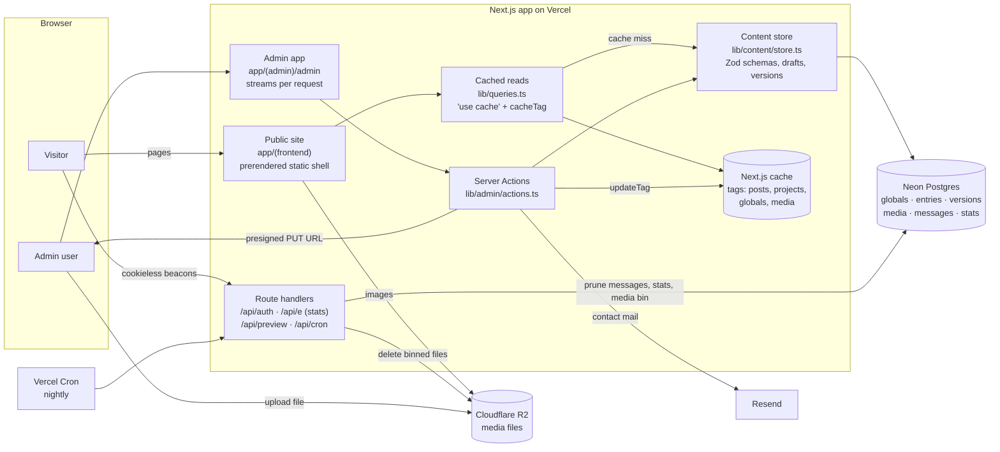
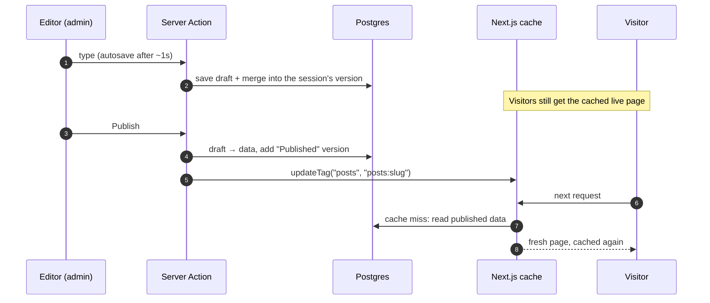
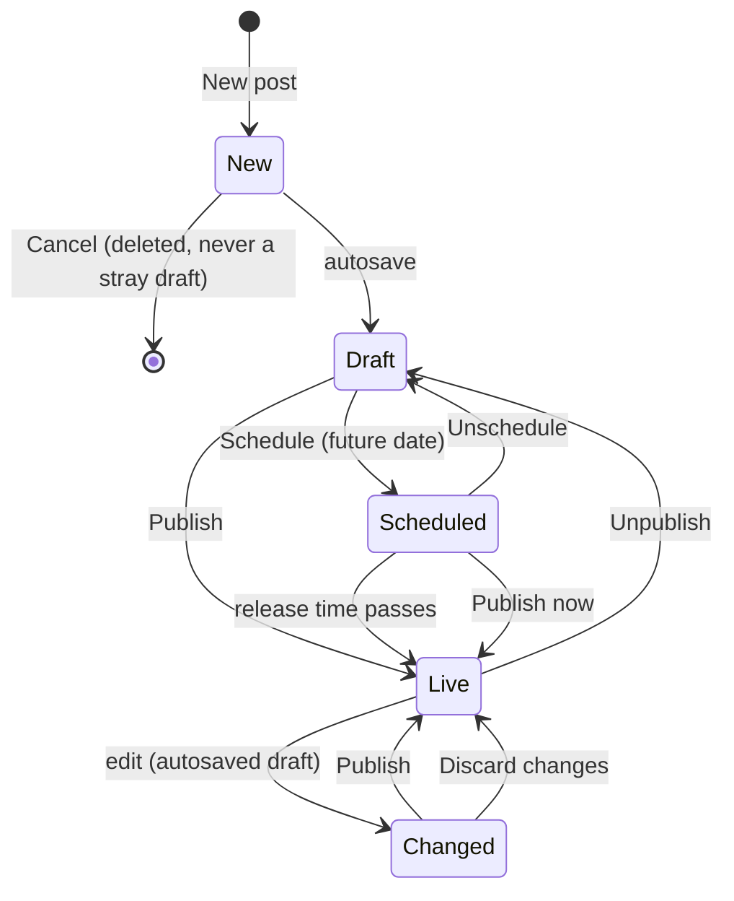
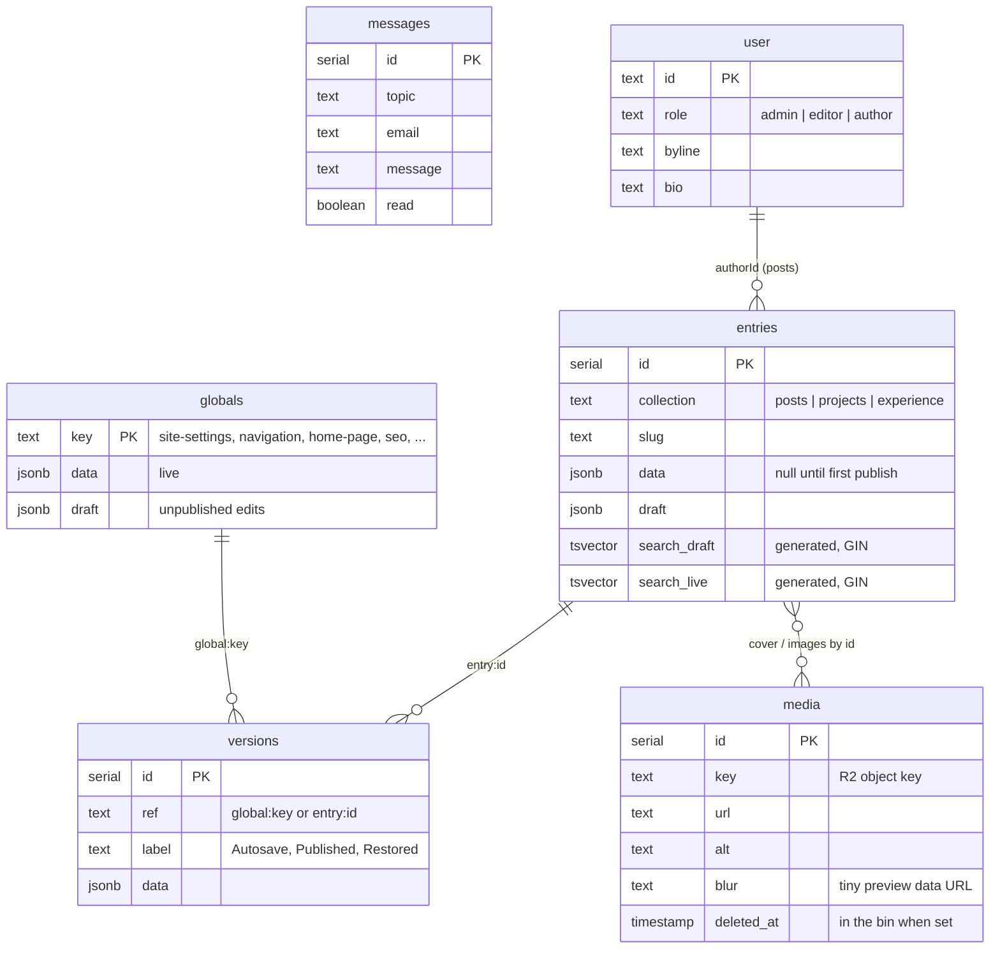

# Architecture

How Stratafolio is put together: request flow, publishing and caching, the content lifecycle, the data model, search, the contour art, and the rules that keep it fast. Back to the [README](../README.md).

- [Overview](#overview)
- [Publishing and caching](#publishing-and-caching)
- [Content lifecycle](#content-lifecycle)
- [Data model](#data-model)
- [Search](#search)
- [Contour art](#contour-art)
- [Project structure](#project-structure)
- [Rules worth keeping](#rules-worth-keeping)

## Overview



## Publishing and caching

Every public read is a `'use cache'` function with the longest lifetime and a tag. Nothing is revalidated on a timer: publishing expires exactly the tags it touched.



Scheduled posts need no queue or worker: the cached post list sets its own `cacheLife` to expire when the next scheduled post goes live.

## Content lifecycle



A post's **stage** (Draft, Writing, Published) is separate from publishing: published Draft and Writing posts show on the blog as "Coming soon".

## Data model



## Search

Each entry has two generated, weighted `tsvector` columns: `search_draft` (what the admin sees) and `search_live` (what's published). Titles weigh most (A), then summaries (B), then category, tags and slug (C), then the rich-text body (D). Queries use the `english` config, so words are stemmed ("caching" finds "cache"), every word is a prefix match, and results are ranked with `ts_rank_cd`. A substring match backs it up for code identifiers. See `lib/search.ts`.

## Contour art

`lib/noise.ts` is a line-for-line TypeScript port of the hero shader's simplex noise and domain warp (`lib/ember.ts`). `lib/topo.ts` traces contour lines through that field with marching squares while pages prerender, so cards, covers, the footer and Open Graph images are patches of the same terrain the hero animates, shipped as plain SVG. Change the shader and `lib/noise.ts` together.

## Project structure

Everything sits at the project root (no `src/` folder):

```
app/(frontend)/        portfolio: home, /work/[slug], /privacy, OG images, sitemap
app/(blog)/            standalone blog (own header/footer): /blog, /blog/[slug], /blog/feed.xml (RSS)
app/(admin)/admin/     login + the admin app (dashboard, builder, posts, projects, experience,
                       toolkit, media, messages, stats, settings/[tab])
app/api/               auth/[...all], e (stats collector; GET = "is this browser counted?"),
                       cron/retention, admin/upload-local (dev)
                       (draft preview lives at app/(frontend)/api/preview)
app/actions/           contact Server Action (validate → save → email via Resend)
db/                    Drizzle schema + client
drizzle/               SQL migrations
components/            site: sections/, header/, menu/, footer/, blog/, contact/, consent/, hero/, ui/
components/admin/      shell, form kit, DatePicker, Select, EntryTable, media, rich/ (Tiptap), editors/
lib/content/           schemas (Zod), store (reads/writes/versions), schedule, diff, revalidate
lib/admin/             Server Actions, list rows, nav counts, admin store
lib/                   queries (cached reads), search, auth, storage, noise + topo, ember (shader), og
seed/                  starter content
styles/                preflight.css, site.css, blog.css, app.css (site); admin.css, admin-app.css
docs/SPEC.md           product spec, design rules and release checklist
```

## Rules worth keeping

**Cache Components**

- No `export const dynamic` or `revalidate` on routes.
- Request data (`cookies()`, `headers()`, `searchParams`, the session) only inside `<Suspense>` or after `await connection()`.
- No `Date.now()` / `Math.random()` during a prerender outside `'use cache'` (see `lib/now.ts`).
- Scripts that write the database can't expire the running server's cache; publish from the admin instead.
- Applied migrations never run again: ship content or schema fixes as a new migration.

**Design** (treat violations as bugs; full list in [`docs/SPEC.md`](SPEC.md))

- One WebGL canvas, in the hero only.
- Hovers never change font weight, size, spacing or padding, and never move the hovered element.
- No magnetic buttons, no cursor-glow spotlights. RSS is off by default (Blog settings → RSS feed).
- Every animation has a `prefers-reduced-motion` path; content is visible without JavaScript.
